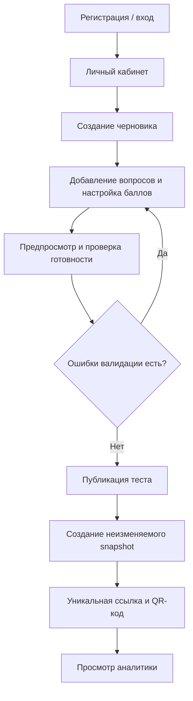
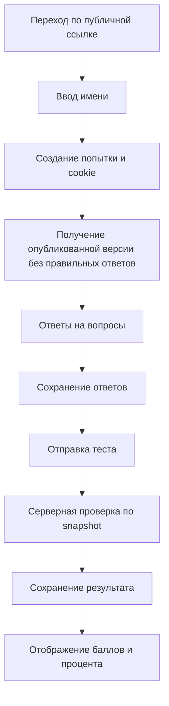
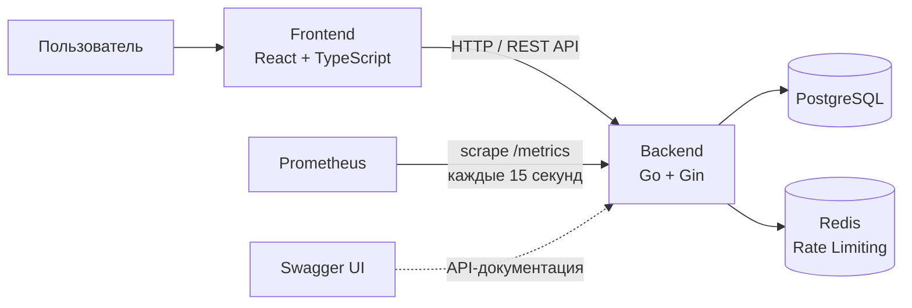
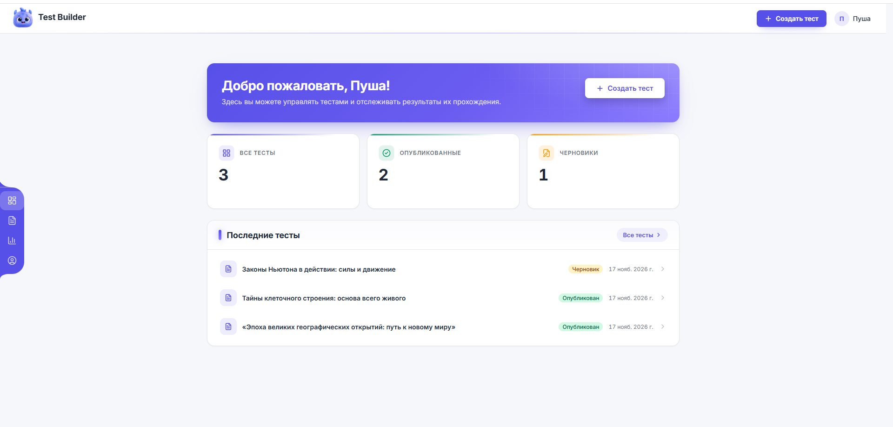
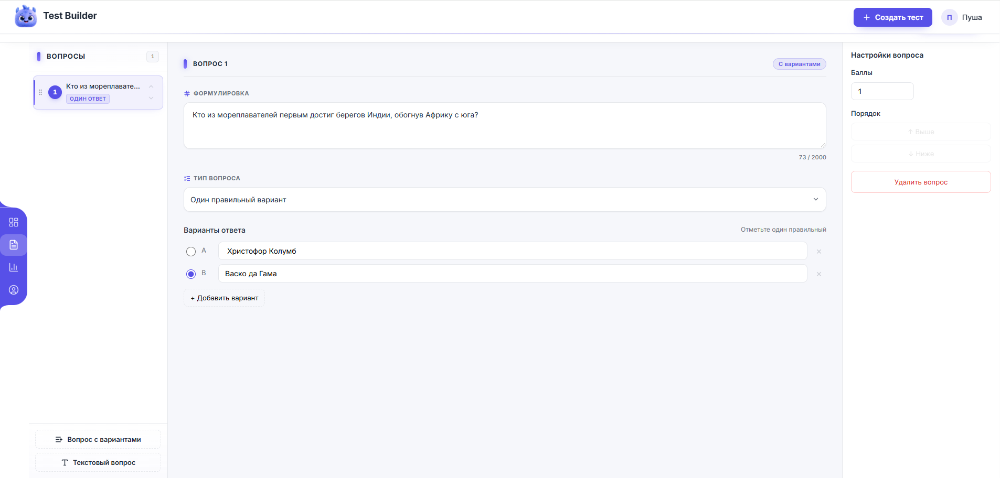
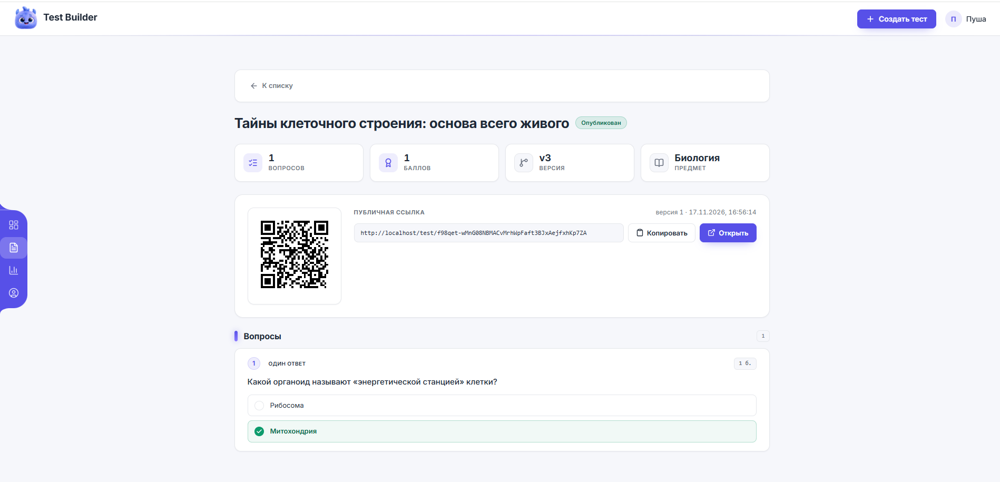
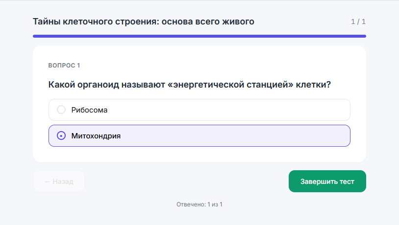
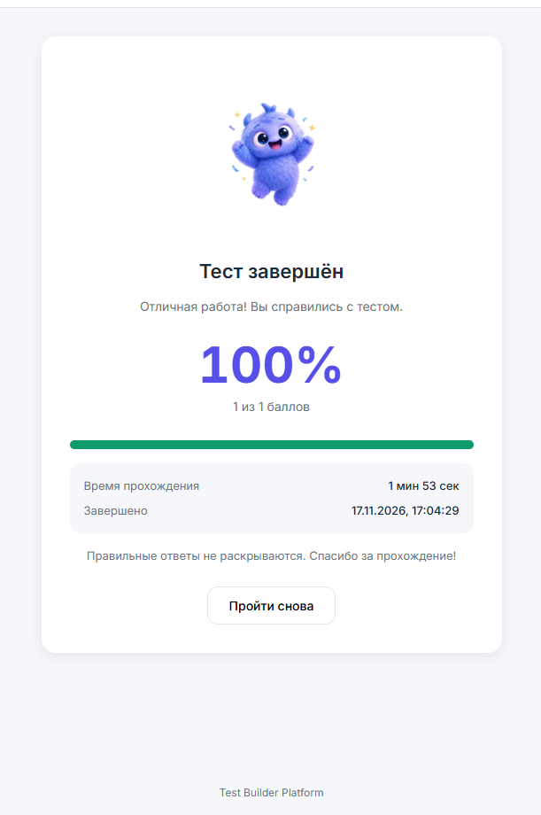
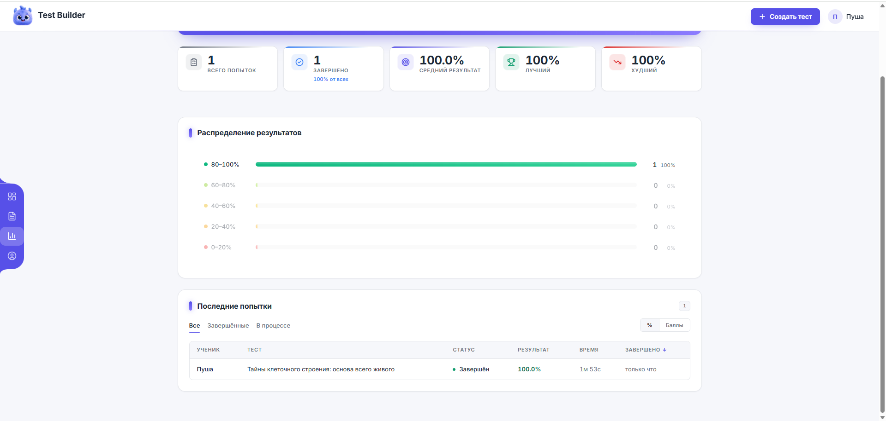
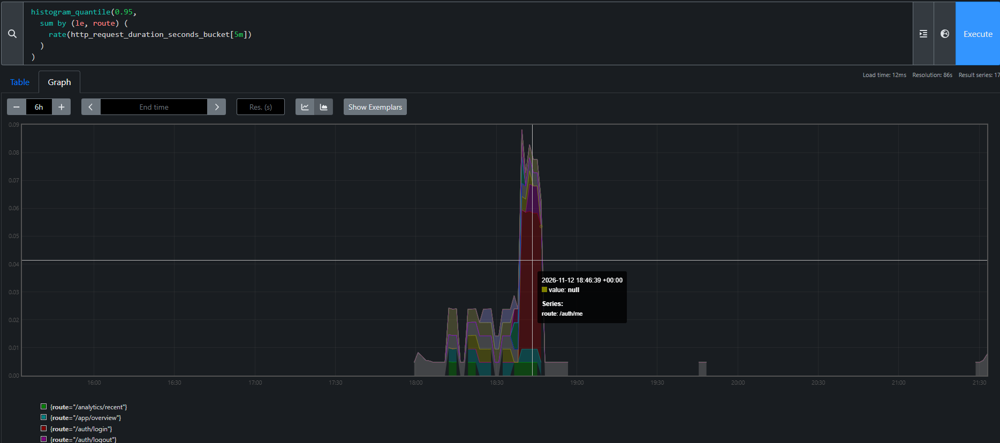

  

<h1 align="center">Test Builder Platform</h1>

  Платформа для создания, публикации и прохождения онлайн-тестов
   
  <strong>Fullstack Development · System Analysis · Product Thinking</strong>

  
  
  
  
  
  

---

## О проекте

**Test Builder Platform** — веб-приложение для преподавателей, репетиторов и авторов курсов. Создатель формирует тест, проверяет его готовность, публикует по уникальной ссылке или QR-коду и отслеживает результаты. Участник проходит тест без регистрации: указывает имя, отвечает на вопросы и получает рассчитанный результат.

Проект демонстрирует полный цикл разработки продукта: от проработки требований и пользовательских сценариев до реализации frontend, backend, API, хранения данных, контроля доступа, тестирования и мониторинга.

### Ключевые возможности

| Для создателя | Для участника |
|---|---|
| Регистрация и вход в систему | Прохождение без создания аккаунта |
| Создание и редактирование черновиков | Ввод имени перед началом теста |
| Вопросы `single_choice` и `text` | Сохранение ответов на сервере |
| Настройка вариантов, баллов и порядка вопросов | Получение результата после отправки |
| Предпросмотр и проверка готовности | Защищённая сессия прохождения |
| Публикация и получение ссылки/QR-кода | — |
| Сводная аналитика и последние попытки | — |

---

## Моя роль: Fullstack Developer & System Analyst

В проекте совмещены задачи разработки и системного анализа.

| Направление | Что сделано |
|---|---|
| **Frontend** | Реализованы пользовательские страницы, личный кабинет, редактор тестов, публичное прохождение, страницы результата и аналитики на React и TypeScript. |
| **Backend** | Разработан REST API на Go и Gin: авторизация, управление тестами, публикация, попытки прохождения, проверка ответов и аналитика. |
| **Работа с данными** | Спроектировано хранение пользователей, сессий, тестов, вопросов, публикаций, попыток и ответов в PostgreSQL. |
| **Системный анализ** | Определены роли пользователей, функциональные требования, Use Cases, User Stories, бизнес-правила, API-контракты и нефункциональные требования. |
| **Надёжность и безопасность** | Реализованы контроль доступа, серверные сессии, CSRF-защита, rate limiting, транзакции, optimistic locking и идемпотентная обработка завершения попытки. |
| **Качество и эксплуатация** | Добавлены handler- и repository-интеграционные тесты, Swagger-документация и мониторинг Prometheus. |

---

## Как работает продукт

### Сценарий создателя

### Сценарий участника

---

## Архитектура

**Основные компоненты:**

- **Frontend:** React, TypeScript.
- **Backend:** Go, Gin, REST API.
- **Хранение данных:** PostgreSQL; миграции управляются Goose.
- **Ограничение запросов:** Redis.
- **Инфраструктура:** Docker Compose.
- **API-документация:** Swagger UI (`swaggo/gin-swagger`).
- **Мониторинг:** Prometheus и endpoint `/metrics`.
- **Интеграционные тесты:** Testcontainers.

---

## Системный анализ

В рамках проекта проработаны не только экраны и API, но и правила взаимодействия пользователей с системой.

### Пользователи и доступ

| Роль | Возможности | Авторизация |
|---|---|---|
| Создатель тестов | Создание, редактирование, публикация тестов и просмотр аналитики | Требуется |
| Участник | Прохождение опубликованного теста и получение результата | Не требуется |
| Система | Проверка прав, сохранение данных, расчёт результата и формирование аналитики | — |

В продукте предусмотрен один тип аккаунта — создатель тестов. Участник не регистрируется: его попытка идентифицируется отдельным секретом сессии.

### Аналитические артефакты

- Функциональные и нефункциональные требования.
- Use Cases для регистрации, авторизации, создания и публикации теста, прохождения, получения результата и аналитики.
- User Story Map реализованной версии.
- Таблица бизнес-правил с идентификаторами `RULE-01`–`RULE-12`.
- Описание пользовательских ролей и прав доступа.
- REST API: методы, endpoint'ы и назначение операций.
- Концептуальная модель данных и перечень сущностей.
- Правила валидации, публикации, проверки ответов и обработки повторных запросов.

### Основные бизнес-правила

| Правило | Реализация |
|---|---|
| Черновик доступен только владельцу | `owner_id` определяется по серверной сессии; для чужого объекта возвращается `404` |
| Опубликованная версия не изменяется | Снимок теста хранится в JSONB; неизменяемость дополнительно контролируется триггером БД |
| Попытка относится к публикации, а не к черновику | Проверка выполняется по опубликованному snapshot |
| Правильные ответы не раскрываются участнику | Публичные DTO не содержат ключей проверки |
| Ответ `single_choice` должен относиться к вопросу публикации | Сервер проверяет принадлежность варианта ответа опубликованному вопросу |
| Текстовый ответ нормализуется | Применяются `trim` и `lower`; пунктуация сохраняется, затем выполняется точное сравнение |
| Повторная отправка завершённой попытки не создаёт новый результат | Сохраняется и возвращается ранее рассчитанный результат |
| Конфликт версий черновика не приводит к перезаписи | Используется `expectedRevision` (optimistic locking) |

### Модель данных

В предметной области используются следующие основные сущности:

`users` · `auth_sessions` · `tests` · `questions` · `answer_options` · `test_publications` · `attempts` · `attempt_answers`.

Опубликованный тест сохраняется как JSONB snapshot. Это позволяет проверять попытки по той версии теста, которую участник действительно проходил, даже если исходный черновик больше не используется.

---

## Backend API

API сгруппирован по бизнес-возможностям. Все маршруты имеют префикс `/api`.

| Группа | Примеры endpoint'ов | Назначение |
|---|---|---|
| Авторизация | `POST /api/auth/register` · `POST /api/auth/login` · `POST /api/auth/logout` · `GET /api/auth/me` | Регистрация, вход, выход и проверка сессии |
| Тесты | `GET /api/tests` · `POST /api/tests` · `GET /api/tests/:id` · `PUT /api/tests/:id/draft` | Создание и управление черновиками |
| Публикация | `POST /api/tests/:id/validate` · `POST /api/tests/:id/publish` | Проверка готовности и публикация |
| Публичное прохождение | `GET /api/public/tests/:token` · `POST /api/public/tests/:token/attempts` | Получение теста и создание попытки |
| Ответы и результат | `PUT /api/public/attempts/:attemptId/answers` · `POST /api/public/attempts/:attemptId/submit` · `GET /api/public/attempts/:attemptId/result` | Сохранение ответов, проверка и получение результата |
| Аналитика | `GET /api/analytics/recent?limit=N` | Последние попытки текущего создателя |

Полная спецификация доступна через Swagger UI.

---

## Технические решения и безопасность

| Задача | Решение |
|---|---|
| Защита паролей | Хранение bcrypt-хеша; минимальная длина пароля — 12 символов |
| Управление сессиями создателя | Серверные сессии и `HttpOnly` cookie (`tbp_session`; в production — `__Host-tbp_session`) |
| Защита изменяющих запросов | CSRF-токен в заголовке `X-CSRF-Token` для POST/PUT/DELETE |
| Изоляция данных | Проверка владельца на backend; идентификатор берётся из сессии, а не из тела запроса |
| Защита попытки участника | Отдельная `HttpOnly` cookie; в БД хранится SHA-256-хеш секрета |
| Защита правильных ответов | Разделение публичных и внутренних DTO |
| Защита от частых запросов | Redis rate limiting для авторизации и публичных endpoint'ов |
| Конкурентное сохранение | `expectedRevision` и optimistic locking |
| Целостность операций | Транзакции PostgreSQL и откат при ошибках |
| Конкурентное завершение попытки | `SELECT FOR UPDATE`; повторная отправка возвращает сохранённый результат |
| Валидация данных | Проверки на backend и ограничения `CHECK` в БД |

### Почему опубликованная версия — snapshot

Публикация создаёт отдельный неизменяемый снимок теста. Попытка участника связана именно с этой версией, а не с редактируемым черновиком. Поэтому изменение исходного теста не меняет содержание уже опубликованной версии и не влияет на проверку ранее начатых попыток.

---

## Тестирование и мониторинг

### Автоматизированные тесты

- Handler-тесты: dashboard, tests, publications, attempts и analytics.
- Repository-интеграционные тесты с Testcontainers: dashboard, tests и attempts.

### Prometheus

Для наблюдения за HTTP-слоем, бизнес-событиями и состоянием Go-процесса интегрирован Prometheus.

| Метрика | Что позволяет отслеживать |
|---|---|
| `http_requests_total` | Количество запросов с разбивкой по методу, маршруту и статусу |
| `http_request_duration_seconds` | Время обработки запросов и latency по маршрутам |
| `tests_created_total` | Количество созданных тестов |
| `rate_limited_requests_total` | Количество запросов, отклонённых rate limiting |
| `go_goroutines`, `go_memstats_*` | Состояние Go runtime и использование памяти |
| `process_cpu_seconds_total` | Использование CPU процессом |

Prometheus собирает метрики с интервалом 15 секунд. Endpoint `/metrics` доступен внутри Docker-сети и не проксируется наружу. В интерфейсе Prometheus можно проверить статус target (`UP`/`DOWN`) и выполнять PromQL-запросы для анализа RPS, доли ошибок, p95 latency и срабатываний rate limiting.

---

<strong>Личный кабинет</strong>

<strong>Редактор теста</strong>

<strong>Проверка и публикация</strong>

<strong>Публичное прохождение</strong>

<strong>Результат</strong>

<strong>Аналитика</strong>

<strong>Prometheus</strong>

---

## Документация

Подробное описание реализованной версии включает:

- назначение продукта и роли пользователей;
- функциональные требования и бизнес-правила;
- Use Cases и User Story Map;
- пользовательские сценарии;
- REST API и frontend-маршруты;
- техническую реализацию, безопасность, тестирование и Prometheus.

Основной документ проекта: [`docs/product-v1.md`](docs/product-v1.md).

---

  <strong>Test Builder Platform</strong> 
  От требований и проектирования до работающего fullstack-продукта.

